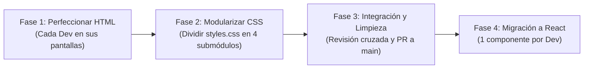

# 🚀 Plan de Trabajo Colaborativo (4 Personas en GitHub)
## Proyecto: LinguaStep A1 (HTML + Tailwind CSS hacia React)

Este documento detalla la estrategia de ramificación, división de tareas por fases y buenas prácticas para que **4 desarrolladores** trabajen en paralelo en el mismo repositorio de GitHub sin pisarse código ni generar conflictos de fusión (*merge conflicts*).

---

## 🎯 Regla de Oro para Evitar Conflictos

> **"Un desarrollador por archivo / módulo a la vez."**
> La causa #1 de conflictos en GitHub es que dos personas editen el mismo archivo al mismo tiempo (especialmente `styles.css` o el mismo `.html`). Este plan aísla el trabajo de cada integrante mediante división de archivos y modularización.

---

## 👥 Asignación de Roles y Pantallas

Dado que el proyecto tiene **9 pantallas HTML**, se distribuyen en 4 áreas funcionales bien delimitadas:

| Desarrollador | Módulo Funcional | Archivos Asignados (Propiedad Exclusiva) |
|---|---|---|
| **Dev 1** | **Público y Autenticación** | `index.html`<br>`login.html` |
| **Dev 2** | **Portal del Estudiante** | `student-dashboard.html`<br>`lesson.html`<br>`quiz-results.html` |
| **Dev 3** | **Portal Docente y Progreso** | `teacher-dashboard.html`<br>`teacher-progress.html` |
| **Dev 4** | **Gestión de Contenido y Preguntas** | `lesson-editor.html`<br>`question-management.html` |

---

## 📅 Roadmap por Fases



---

### 🔹 Fase 1: Perfeccionamiento y Cierre Total del HTML

**Objetivo:** Dejar la estructura HTML 100% terminada, semántica, accesible y con etiquetas autocerradas antes de tocar estilos profundos.

* **Dev 1 (Landing & Auth):**
  * Verificar estructura del Hero, Bento Grid de presentación y pie de página en `index.html`.
  * Validar formularios de Login y Registro en `login.html` (inputs con sus respectivos `type="email"`, `type="password"`, `required`, etiquetas `<label>` vinculadas con `id`).
* **Dev 2 (Experiencia Estudiante):**
  * Revisar accesibilidad del reproductor simulado, tarjetas Bento de vocabulario en `lesson.html`.
  * Afinar la tarjeta circular de puntaje SVG y lista de respuestas en `quiz-results.html`.
  * Revisar la tabla de actividades y anillos de progreso en `student-dashboard.html`.
* **Dev 3 (Dashboard Profesor):**
  * Estructurar métricas, tablas de lecciones y acciones de edición en `teacher-dashboard.html`.
  * Validar los filtros, cabeceras y paginación de la tabla de alumnos en `teacher-progress.html`.
* **Dev 4 (Editor y Preguntas):**
  * Asegurar todos los campos del formulario de creación de lección y taxonomía en `lesson-editor.html`.
  * Afinar las tarjetas de preguntas y el modal de confirmación en `question-management.html`.

> [!IMPORTANT]
> Durante la Fase 1, **nadie edita `assets/css/styles.css`**. Si alguien necesita una clase rápida, utiliza clases nativas de Tailwind en su propio archivo HTML.

---

### 🔹 Fase 2: División Modular del CSS (Cero Conflictos)

Actualmente todos los estilos personalizados residen en `assets/css/styles.css`. Para evitar que los 4 desarrolladores choquen editando este archivo, **se subdivide la carpeta `assets/css/`**:

```text
assets/css/
├── styles.css             # Archivo maestro que solo importa a los demás
├── base.css               # Fuentes, colores base, configuración general (Dev 1)
├── student.css            # Animaciones de progreso y lecciones (Dev 2)
├── teacher.css            # Tablas docentes, insignias y estados (Dev 3)
└── forms-admin.css        # Modales, toggles e inputs de administración (Dev 4)
```

#### Contenido del archivo maestro (`assets/css/styles.css`):
```css
@import url('base.css');
@import url('student.css');
@import url('teacher.css');
@import url('forms-admin.css');
```

#### Asignación de archivos CSS:
1. **Dev 1 ➔ `base.css`:** Tipografías (`Plus Jakarta Sans`, `Atkinson Hyperlegible Next`), variables de color de fondo, resets y Material Symbols.
2. **Dev 2 ➔ `student.css`:** Efectos hover de tarjetas interactivas (`tactile-card`), animación del SVG circular (`progress-ring__circle`) y estilos de tarjetas de resultados.
3. **Dev 3 ➔ `teacher.css`:** Estilos visuales de tablas de progreso, bordes de métricas y estados de estudiantes.
4. **Dev 4 ➔ `forms-admin.css`:** Estilos para switches (`toggle-checkbox`), inputs táctiles (`form-input`, `brand-input`) y transiciones de modales (`scale-95`).

---

### 🔹 Fase 3: Integración y Verificación Cruzada

1. Cada desarrollador abre las 9 pantallas en su navegador para validar que no haya estilos rotos.
2. Comprobar que todas las rutas relativas (`assets/img/...`) carguen correctamente.
3. Realizar pruebas de revisión cruzada de código (*Peer Review*):
   * Dev 1 revisa el PR de Dev 2.
   * Dev 2 revisa el PR de Dev 3.
   * Dev 3 revisa el PR de Dev 4.
   * Dev 4 revisa el PR de Dev 1.

---

### 🔹 Fase 4: Preparación para React (Componentización)

Cuando comiencen con React, cada persona transformará su bloque HTML a componentes reutilizables:
* **Dev 1:** `<Navbar />`, `<Footer />`, `<LandingHero />`, `<AuthCard />`.
* **Dev 2:** `<StudentSidebar />`, `<ProgressRing />`, `<LessonCard />`, `<QuizSummary />`.
* **Dev 3:** `<TeacherSidebar />`, `<StatsGrid />`, `<StudentProgressTable />`.
* **Dev 4:** `<QuestionEditor />`, `<QuestionCard />`, `<ConfirmModal />`, `<ToggleSwitch />`.

---

## 🌿 Flujo de Trabajo en GitHub (Git Flow Simplificado)

### 1. Convención de Ramas (*Branching Strategy*)
Nunca se hace `commit` directo en la rama `main`. Cada persona crea una rama con el prefijo de su módulo:

* `feat/dev1-landing-auth`
* `feat/dev2-student-portal`
* `feat/dev3-teacher-portal`
* `feat/dev4-admin-questions`

### 2. Ciclo de Trabajo Diario Paso a Paso

```bash
# 1. Antes de empezar el día, actualizar la rama main local
git checkout main
git pull origin main

# 2. Crear o cambiarse a su rama de trabajo
git checkout -b feat/dev1-landing-auth
# (o si ya existe: git checkout feat/dev1-landing-auth && git rebase main)

# 3. Trabajar ÚNICAMENTE en sus archivos asignados
# 4. Guardar cambios con commits claros y atómicos
git add index.html login.html
git commit -m "feat(auth): afinar formulario de registro y accesibilidad de inputs"

# 5. Subir cambios a su rama en GitHub
git push -u origin feat/dev1-landing-auth
```

### 3. Apertura de Pull Request (PR)
* Abrir el PR en GitHub hacia `main`.
* Titular claramente: `[Fase 1] Finalización HTML módulo Auth (Dev 1)`.
* Requerir **al menos 1 aprobación (review)** de un compañero de equipo antes de hacer merge.
* Marcar la opción **"Squash and merge"** o **"Rebase and merge"** para mantener el historial de `main` limpio.

---

## 🛡️ Protocolo Anticolisión (¿Qué hacer si hay conflicto?)

1. **Si dos personas necesitan editar el mismo archivo:**
   * No lo editen a la vez. Una persona termina su cambio, hace merge a `main`, y la segunda persona hace `git pull origin main --rebase` antes de aplicar sus modificaciones.
2. **Si GitHub marca un conflicto:**
   ```bash
   git checkout mi-rama
   git fetch origin
   git merge origin/main
   # Resolver manualmente en VS Code los marcadores <<<<<<< HEAD
   git add <archivo-resuelto>
   git commit -m "chore: resolver conflicto con main"
   git push origin mi-rama
   ```

---

## ✅ Checklist de Salida por Desarrollador

- [ ] ¿Modifiqué **únicamente** los archivos que me fueron asignados?
- [ ] ¿Todas las etiquetas vacías (``, `<input>`) tienen cierre autocerrado `/>`?
- [ ] ¿Verifiqué que no haya clases rotas en mi pantalla?
- [ ] ¿Probé que las imágenes de `assets/img/` se visualicen correctamente?
- [ ] ¿Mi Pull Request fue revisado y aprobado por otro compañero?
